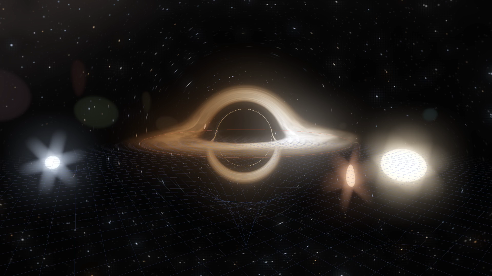

# Sagittarius A*: exploring a black hole

Fly around a glowing disk, watch starlight bend around the hole and its suns, watch suns pulled into the hole and torn apart, make gravity's invisible pull visible, and compare the black hole's shadow with a mathematical prediction. My C++ simulator follows light through Schwarzschild spacetime at the mass of Sagittarius A*, the black hole at the centre of the Milky Way.

## How it started

The ring of light around Sagittarius A* is about 52 microarcseconds across; the Event Horizon Telescope needed radio dishes spread across the planet to see it. For a non-rotating black hole, its mass fixes the shadow's physical size; its distance sets how large that shadow appears in the sky. I could calculate an image instead of photographing it. In 1979 Jean-Pierre Luminet did exactly that. He calculated what a black hole ringed by a thin disk of gas would look like, on an early computer fed with punched cards, and drew the result by hand. It was the first image of a black hole. I wanted one I could move around in.

To get there I had to learn two things. Ray tracing came from *Ray Tracing in One Weekend*: follow light backwards from the eye, one pixel at a time. I learned about geodesics and camera frames from 20k's Schwarzschild rendering article, and backward tracing and frequency shifts from Rishabh Hariharan's Python example. My first working version was a Python script. It traced one still image with a flat disk, no Doppler shift and no colour grading, and it was far too slow to move around in. The current [Python companion](prototype/) demonstrates that basic approach in a small teaching program.

Next I learned shaders. A fragment shader runs one small program per pixel on the graphics card, which is exactly the shape of ray tracing, so I moved the tracing to the GPU and wrote the program around it in C++ with OpenGL. The picture now redraws while you drag the camera.

Then I tested it. The edge of a black hole's shadow has an exact prediction, so I drew that ring over the image. In my first C++ version the shadow came out a third too small: a wrong term in the equations let light escape too easily, and the camera transformation was off. Once I corrected both, the edge sat on the ring; it now fits to within 0.4% at every distance I measured.

I also wanted to explore what happens when suns interact near the hole. The current tracer follows a Cartesian form of the orbit equation, avoiding the poles of a spherical coordinate system. The suns pull on one another while orbiting a fixed black hole: the hole's tides stretch a sun that comes too close and then tear it into a stream of debris that spirals in. The suns bend light too, a curved-space sheet sinks under the hole and under each sun, arrows show gravity's pull, and bright suns throw a camera-style lens flare. A STAGE button illustrates the learning path on the full scene, and [learning/](learning/) walks through the same ideas in six small shaders.

The shadow test has a limit. It checks where light falls in, not whether the disk's brightness and colours are right; those follow rules I chose, with nothing exact to compare them against. How people who build black-hole renderers test the parts of an image that have no exact answer is the next thing I want to learn.

## How it works

For every pixel, a ray starts at the camera and is followed backwards. In Schwarzschild spacetime a light ray stays in one plane and obeys u″ + u = 3/2 u², with u = r_s/r. Written for the ray's position vector x, the same paths solve x″ = −3/2 h² x / r⁵, where h is the ray's conserved angular momentum. A fourth-order Runge–Kutta integrator advances each ray in steps of 1% to 8% of its distance from the hole. A ray can fall in, hit a sun, cross the disk or escape to the sky.

- **The disk** is thin. Where a ray crosses it, the gas adds light weighted by how transparent the earlier crossings left it, so the disk shows above and below the shadow as its light bends around the hole. Gas moving towards the camera is Doppler-shifted brighter and bluer, and all of it is reddened climbing out of the hole's gravity.
- **The suns move under gravity.** Each pulls on the others and is pulled by the hole, so their orbits wander and can tangle. As a sun nears the hole, the tide stretches it along the line to the hole; inside the tidal radius (8.9 Schwarzschild radii for a Sun-like star) it is torn into debris, which streams around and falls in, brightening the disk. Suns that touch destroy each other, a slingshot can throw one out, and when all are gone new ones arrive.
- **The suns bend light** with the same exaggerated masses they use to pull on one another (6–10% of the hole's). Far from a mass m, light is deflected by 4Gm/(c²b). That weak-field bending is added as a small kick at each step; it stretches the stars behind a sun and can wrap them into an Einstein ring.
- **The curved-space sheet** is a picture rather than part of the light calculation: a grid under the disk that sinks into a well under the hole and a smaller well under each sun, deeper for more mass.
- **The gravity arrows** show the Newtonian pull that the hole and the suns would exert at each point of the sheet, and the net pull on each sun; longer and warmer means stronger.
- **The lens flare** imitates a camera lens, not anything in space. It is built from the traced suns' light, so a sun hidden behind the hole makes no flare.

A separate 2D view, `BlackHole2D`, fires a row of parallel rays past the hole and draws their paths.

## Open and explore

On macOS, install CMake, GLFW, GLEW and GLM, then double-click [Open Black Hole.command](Open%20Black%20Hole.command). The [build guide](sim/README.md) has the commands and a map of the source. FFmpeg is needed for recording and for the shadow measurement.

For a guided explanation, open the [six shader lessons](learning/README.md). The [Python example](prototype/README.md) gives a small CPU version to read alongside the interactive program. Both are clearly labelled companions to `sim/`.

Buttons in the lower-left corner switch the views on and off: the learning stage, curved space, gravity arrows, suns bending light, the sky grid, the lens flare, the predicted shadow edge, the suns' mutual pull and the tides that tear them apart. Every button also has a key.

The STAGE button (keys 1, 2, 3) illustrates the learning steps using the current renderer: **1** ordinary ray tracing with straight light, **2** light bent by the hole with a plain disk, **3** everything. For the ideas one at a time, double-click [Open Shader Lessons.command](Open%20Shader%20Lessons.command); the [lessons guide](learning/README.md) shows each step.

| Control | Action |
|---|---|
| Drag or arrow keys | Rotate the view |
| Scroll, W/S or +/− | Zoom |
| Space | Freeze time for the sharpest image |
| 1 / 2 / 3 | Learning stage: straight light / bent light / everything |
| E / A / G | Curved-space sheet / gravity arrows / suns bend light |
| H / O / K | Lensed sky grid / lens flare / predicted shadow edge |
| N / F / R | Suns pull on one another / tides tear suns apart / new suns |
| C / T / D | Ghost copy started 12.7 km away / trails / disk |
| L / U | Grid diagnostic look / hide the buttons |
| P / V | Save a screenshot / record video |

The launcher saves optional captures in `sim/build/captures/`, inside the ignored build folder. Use `--out DIR` to choose another location.

## Physical model

The mass is **4.30 million solar masses**, the rounded GRAVITY estimate reported by [ESO](https://www.eso.org/public/news/eso2119/), which makes the Schwarzschild radius about **12.70 million kilometres**. The hole does not rotate. The disk, glow, sky, sun sizes and playback speed are illustrative; this is not a reconstruction of the observed Galactic Centre. The suns' mutual gravity is Newtonian, around a fixed hole, with exaggerated masses; the stretching, tearing and collisions are approximate pictures of what tides and impacts do, not stellar hydrodynamics. [Validation](sim/VALIDATION.md) records what the checks establish and what they do not.

## Explore the project

Run the interactive program using the launcher or build guide above.
- [Rendering stills](Development-images/README.md)
- [Shader lessons](learning/README.md)

The Maker video is submitted separately. This repository contains the working program, technical sources, validation and still images.

## Sources

- Jean-Pierre Luminet, "Image of a spherical black hole with thin accretion disk", *Astronomy and Astrophysics* **75**, 228–235 (1979). The inspiration.
- Peter Shirley, Trevor David Black and Steve Hollasch, [*Ray Tracing in One Weekend*](https://raytracing.github.io/books/RayTracingInOneWeekend.html).
- 20k, ["Implementing General Relativity: Rendering the Schwarzschild black hole, in C++"](https://20k.github.io/c%2B%2B/2024/05/31/schwarzschild.html), 31 May 2024.
- Rishabh Karthikeyan Hariharan, "Simulating a black hole in python", 21 August 2025, [DOI 10.13140/RG.2.2.29922.85441](https://doi.org/10.13140/RG.2.2.29922.85441).

[Sources and methods](docs/SOURCES.md) explains what I learned from each reference, how the current implementation differs, and the tools used in both projects.
