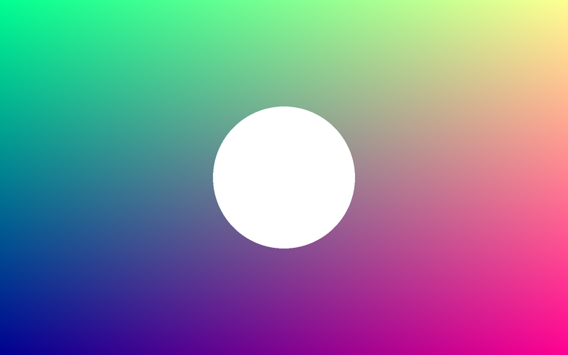
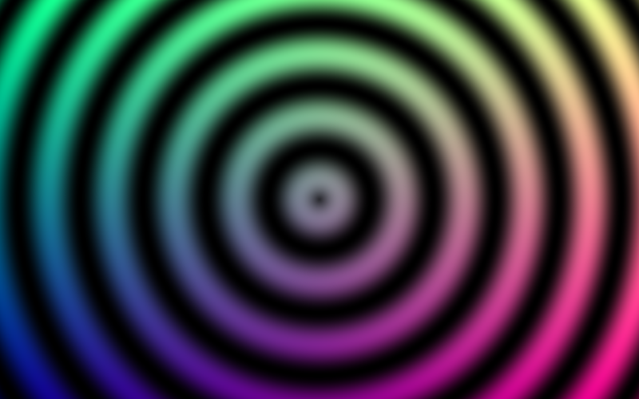
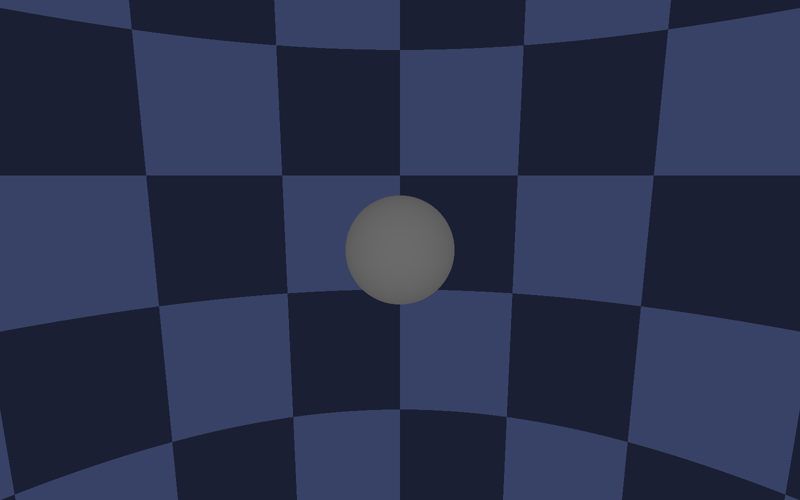
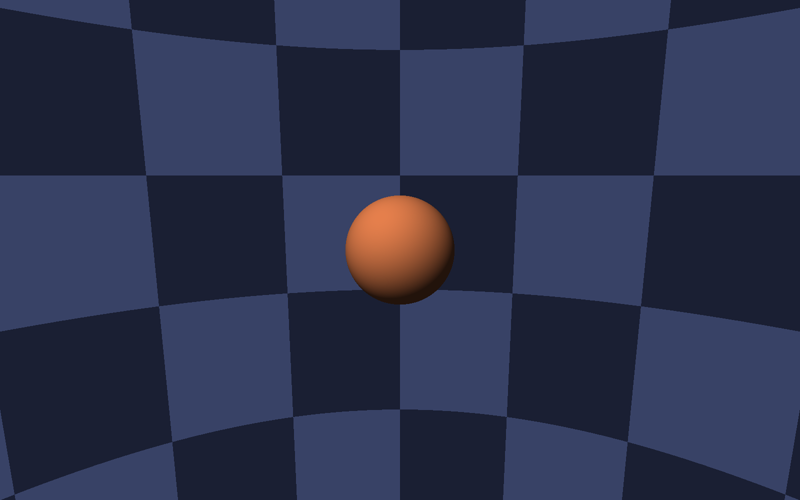
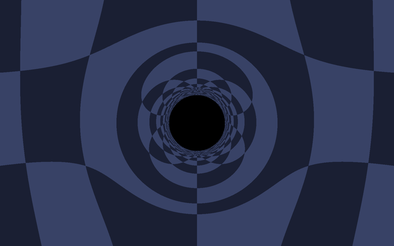
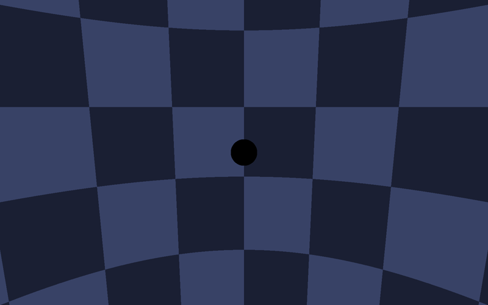
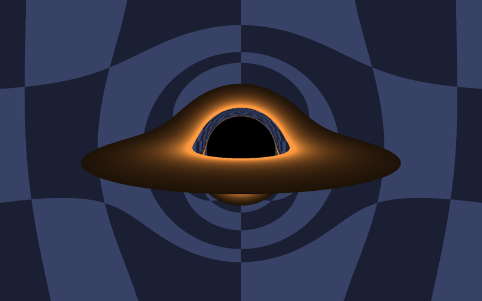
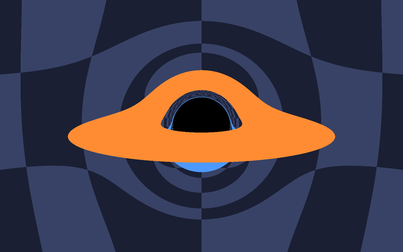
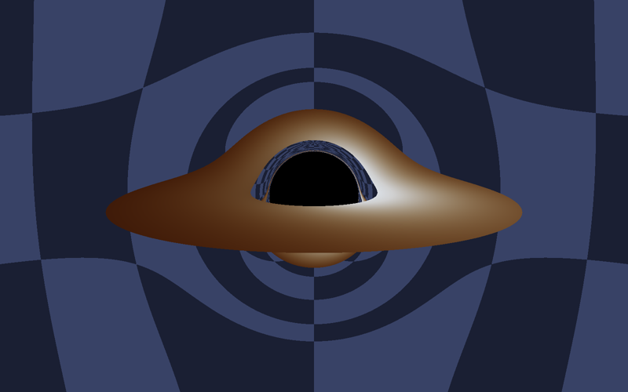

# Shader lessons

I use these six short fragment shaders to explain the ideas behind my simulator, from colouring pixels to a lensed, Doppler-shifted disk. This walkthrough dates from 29 October 2026; it illustrates the learning sequence rather than preserving the original practice files.

Double-click [Open Shader Lessons.command](../Open%20Shader%20Lessons.command), or from this folder:

```sh
cmake -S . -B build -DCMAKE_BUILD_TYPE=Release
cmake --build build
./build/ShaderLessons
```

| Key | Action |
|---|---|
| 1–6 | Choose a lesson |
| T | Each lesson's comparison (the window title says what it shows) |
| R | Reload the lesson after editing its `.frag` file |
| Drag, arrows, scroll | Orbit and zoom the camera |

`./build/ShaderLessons --lesson 4 --compare --save lesson4.png` renders one lesson to a picture.

## The lessons

1. **[Colour each pixel](lessons/1-colour-each-pixel.frag).** A fragment shader runs once for every pixel, in parallel. It knows its position and a few values from C++, and returns a colour. *T: rings computed from each pixel's distance to the centre.*
2. **[Cast a ray](lessons/2-cast-a-ray.frag).** Ray tracing: send a ray from the camera through each pixel and solve for where it meets a ball; otherwise it sees a checkerboard sky. This is the idea in *Ray Tracing in One Weekend*. *T: how far each ray travelled.*
3. **[March the ray](lessons/3-march-the-ray.frag).** The same picture by walking along the ray in steps, because a bent ray has no simple formula. Steps shrink near the ball. *T: how many steps each ray took.*
4. **[Bend the light](lessons/4-bend-the-light.frag).** The ball becomes a black hole. Each ray follows x″ = −3/2 h² x / r⁵, the photon orbit equation of Schwarzschild spacetime, with fourth-order Runge–Kutta steps. The shadow is about 2.6 times wider than the hole, and the sky behind it wraps into rings. *T: gravity off.*
5. **[Add the disk](lessons/5-add-the-disk.frag).** A flat, glowing disk from 3 to 10 Schwarzschild radii, drawn where a ray crosses its plane; roughly what the first Python version drew. *T: colour by crossing order, which shows the far side of the disk seen over the top of the hole.*
6. **[Doppler and redshift](lessons/6-doppler-and-redshift.frag).** The gas moves at a large fraction of light's speed: the approaching side is brighter and bluer, and everything is reddened climbing out of the hole's gravity. *T: shifts off.*

## What each lesson shows

| Lesson | As it opens | With T |
|---|---|---|
| 1. Colour each pixel |  |  |
| 2. Cast a ray |  |  |
| 3. March the ray |  |  |
| 4. Bend the light |  |  |
| 5. Add the disk |  |  |
| 6. Doppler and redshift |  |  |

The pictures were saved with `--save` from the default camera, 20 Schwarzschild radii out and 10 degrees above the disk.

The simulator adds the rest: a starfield and gas texture, suns that bend light and pull on one another, curved-space and gravity views, averaging for smooth edges, a glow, a tone curve, and a progressive renderer that keeps the window responsive. Inside it, the STAGE button replays the same path on the full scene: straight light, then bent light with a plain disk, then everything.
