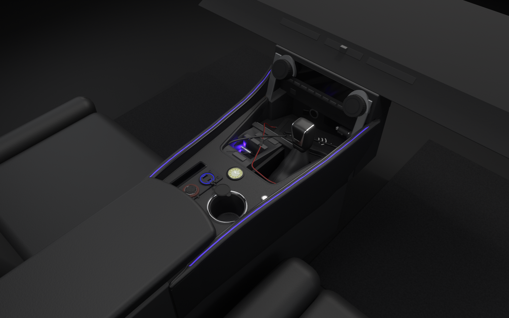

# A console built around the way I use the car

I’m Joric. The factory centre console in my Toyota Wildlander sat too low for my hand, gave me little useful space for my phone and left the charging adapter sticking out. I designed a raised, removable panel to put the phone and charging within reach, with light running along its edges.

I began the 3D design in November 2025 and planned the circuit before cutting and assembling the panel. I started building it in January 2026, cutting the boards, covering them in leatherette, wiring the components and fitting the console. I use the finished panel in the car I drive my brothers to school in.

## From design to build

The design and build dates are my account of the work; the retained photographs and digital files document the completed assembly in October 2026.

| Stage | When | Work |
|---|---|---|
| 3D design | Began November 2025 | Developed the console's shape and layout before fabrication. |
| Circuit planning | Before construction began in January 2026 | Planned the electrical arrangement before installing the components and wiring. |
| Fabrication and installation | Construction began January 2026 | Cut and covered the boards, fitted the components, wired the panel and installed it in the car. |
| Documentation of the completed build | After fabrication; measurement photographs and scan in October 2026 | Recorded the physical console and prepared the saved explanatory model and circuit drawings. |

The editable model and drawings let you inspect the completed console’s construction. Photographs, measurements and the scan support checks against the real panel.

## Inspect the finished panel
- [Photographs of the real panel](photos/)
- [Photographs showing fit and measurements](measurement-photos/)

## How it works

I measured the existing centre console and sized the panel to sit over it, with space underneath for the projecting components. The panel lifts out as one assembly.

One incoming 12 V cable feeds the USB and accessory sockets and a separate wireless charging pad. The pad sits on the tray ahead of the gear lever and connects to the panel through a removable two-pin lead. It is separate from the raised panel but part of the same powered assembly. The silver button latches down when pressed and keeps the lights on after I release it. A controller drives the LED heads: two illuminate the side-glow fibres along the rims, and a third lights the gear-lever area. The red-ringed fitting is a 12 V socket. The clock sits beside the button near the back of the gear-lever notch and runs on its own battery.

## Open the model and circuit

| What you want to inspect | Open this |
|---|---|
| Complete editable 3D scene | [3d/blender/console.blend](3d/blender/console.blend) in Blender |
| Parametric geometry and dimensions | [3d/scad/](3d/scad/) in OpenSCAD; start with [params.scad](3d/scad/params.scad) |
| Individual exported model parts | [3d/stl/](3d/stl/) — 54 STL parts |
| Model assembly code and rebuild guide | [assemble.py](3d/blender/assemble.py) and [3d/README.md](3d/README.md) |
| Installed-wiring schematic | [console_as_built.kicad_pro](circuit/console_as_built.kicad_pro) in KiCad, or the [schematic file](circuit/console_as_built.kicad_sch) |
| Read the installed wiring without KiCad | [console_as_built.pdf](circuit/console_as_built.pdf) |
| Circuit sources, symbols and generators | [circuit/](circuit/README.md) |
| Dimensions and technical notes | [measurements.json](measurements.json) and [docs/](docs/README.md) |
| Finished-build measurement data | [Finished-Build-Scan/](Finished-Build-Scan/README.md) |

The model, circuit and supporting source files are stored here in the portfolio, alongside the photographs and rendered views. The [3D guide](3d/README.md) explains rebuilding the scene; the [circuit guide](circuit/README.md) distinguishes the installed wiring from a proposed improvement.

## See inside the design

[Overall view](3d/renders/hero.png) · [Separated parts](3d/renders/exploded.png) · [Underside](3d/renders/underside.png) · [Lit fibres](3d/renders/fibres_green.png) · [Installed-wiring illustration](circuit/console_as_built.pdf)

These views explain the console's construction. Some dimensions and wire routes are approximate. Dashed connections in the wiring drawing identify routes hidden in the photographs.

## My work

I designed the panel, selected the components, cut and covered the boards, wired the assembly and fitted it in the car. The charging modules, controller, LED heads, fibres and clock are bought components. I use the model and circuit drawings to show how the console fits together. Their scripts keep the geometry parametric and the schematics reproducible. The Maker video is submitted separately.

## Regeneration method

The two Python generators produce the installed-wiring and proposed-improvement schematics so each can be regenerated with its symbols and project settings. The Blender assembly script builds the scene from the parametric part exports, with material colours sampled from photographs. Dimensions live in the shared OpenSCAD parameters; the [3D guide](3d/README.md) and [circuit guide](circuit/README.md) give the rebuild commands. The physical panel was cut from board, covered and wired; the STL files represent its parts and do not imply that the panel was 3D printed.
